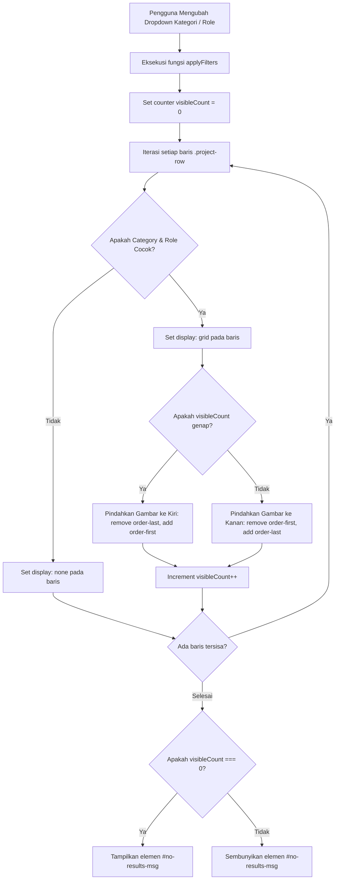

# 🎨 System Architecture & Design Document (DESIGN.md)

> ⚠️ **Dokumen ini ditulis untuk v1.0.0 dan sebagian sudah usang.** Angka versi dan beberapa klaim tidak lagi cocok dengan kode:
> - Reality engine adalah **Astro 7.1.1** (bukan "Astro 5+"); Tailwind v4 dikonfigurasi lewat CSS, bukan lewat `tailwind.config.mjs`.
> - `src/layouts/AdminLayout.astro`, `src/pages/rahasia-admin/*`, dan `src/pages/projects/[slug].astro` **adalah file kosong** yang menghasilkan HTML 0 byte — bukan fitur yang berfungsi. Lihat P0.1 di [REMEDIATION.md](REMEDIATION.md).
> - §4.2 (expand/collapse timeline) menjelaskan tombol yang **dikomentari** di `Experience.astro`.
> - Token warna dark-mode `#0a0a0a` di §2.1 **tidak terpakai** — `global.css` memasang gradient slate via `prefers-color-scheme`. Lihat P0.4.
>
> Dokumen otoritatif untuk kondisi terkini: **[PRD.md](PRD.md)** dan **[REMEDIATION.md](REMEDIATION.md)**.

| Metadata | Keterangan |
| :--- | :--- |
| **Proyek** | Portfolio & Engineering Showcase - Rizky Maulana |
| **Teknologi Utama** | Astro, TypeScript, Tailwind CSS v4, `@astro-icon` |
| **Versi Dokumen** | v1.0.0 |
| **Dokumen Terkait** | [PRD.md](file:///home/rizky-maulana/Documents/Coding/MainProject/Portofolio/docs/PRD.md) |
| **Tanggal Pembuatan** | Oktober 2026 |

---

## 1. Arsitektur Sistem (System Architecture)

### 1.1 Diagram Gambaran Tingkat Tinggi (High-Level Architecture)

Aplikasi portofolio ini dibangun dengan paradigma **Static Site Generation (SSG)** yang mengutamakan pengiriman HTML murni, CSS terkompilasi, dan *zero unnecessary JavaScript* ke peramban.

```mermaid
graph TD
    subgraph Data Layer [Data Layer - Single Source of Truth]
        D1[profile.ts]
        D2[projects.ts]
        D3[experience.ts]
        D4[skills.ts]
        D5[navigation.ts]
        D6[socials.ts]
        D7[certificates.ts]
    end

    subgraph Component Engine [Astro 5+ Engine & Vite]
        UI[Atomic UI: Button, Badge, Card, Container, Section]
        Layouts[Layouts: MainLayout, AdminLayout]
        Sections[Sections: Hero, About, TechStack, FeaturedProject, Experience, Certificates]
        GlobalCSS[Tailwind CSS v4 + @fontsource/inter]
    end

    subgraph Pages Routing [Static Pages / Dist Build]
        P1[index.astro -> /]
        P2[projects.astro -> /projects]
        P3[links.astro -> /links]
        P4[404.astro -> /404]
        P5[projects/slug.astro -> /projects/:slug]
        P6[rahasia-admin -> /rahasia-admin]
    end

    subgraph Target Host [Deployment Distribution]
        GH[GitHub Pages: /Portofolio/]
        CF[Cloudflare Pages / Vercel]
    end

    Data Layer --> Component Engine
    GlobalCSS --> Component Engine
    Component Engine --> Pages Routing
    Pages Routing --> Target Host
```

### 1.2 Pola Pemisahan Data & Presentasi (SSOT Pattern)
Semua entitas data bisnis disimpan secara modular di direktori `src/data/` dengan pengetikan ketat (*strictly typed*) menggunakan antarmuka TypeScript. Komponen antarmuka Astro bertindak murni sebagai lapisan presentasi (*presentation layer*) yang mengonsumsi data tersebut tanpa *hard-coded text*.

---

## 2. Design System & Panduan Gaya UI/UX

Prinsip desain visual yang diusung adalah **Engineering-First Aesthetics**: bersih, tajam, presisi teknis, kontras tinggi, dan minim ornamen visual yang tidak fungsional.

### 2.1 Palet Warna & Semantic Tokens

Sistem warna dibangun di atas fondasi warna netral (*neutral palette*) yang dipadukan dengan aksen *Electric Blue* untuk menarik fokus visual:

```
[ Light Mode Surface: #FFFFFF ] ------> [ Dark Mode Surface: #0A0A0A (neutral-950) ]
[ Light Card: #FAFAFA (neutral-50) ] -> [ Dark Card: #171717 / 40% (neutral-900/40) ]
[ Light Border: #E5E5E5 (neutral-200) ]> [ Dark Border: #262626 (neutral-800) ]
[ Accent Light: #2563EB (blue-600) ] -> [ Accent Dark: #60A5FA (blue-400) ]
```

| Token UI | Tema Terang (Light Mode) | Tema Gelap (Dark Mode) | Penggunaan |
| :--- | :--- | :--- | :--- |
| **Background Utama** | `#ffffff` (`bg-white`) | `#0a0a0a` (`dark:bg-neutral-950`) | Latar belakang dasar halaman |
| **Surface Sekunder** | `#fafafa` (`bg-neutral-50`) | `#171717` (`dark:bg-neutral-900/40`) | Kartu, dropdown filter, seksi alternatif |
| **Border / Divider** | `#e5e5e5` (`border-neutral-200`) | `#262626` (`dark:border-neutral-800`) | Garis pemisah komponen dan bingkai kartu |
| **Teks Primer** | `#171717` (`text-neutral-900`) | `#ffffff` / `#f5f5f5` (`dark:text-white`) | Heading, judul proyek, nama peran |
| **Teks Sekunder** | `#525252` (`text-neutral-600`) | `#a3a3a3` (`dark:text-neutral-400`) | Paragraf deskripsi, label, tanggal |
| **Teks Tersier / Muted** | `#a3a3a3` (`text-neutral-400`) | `#737373` (`dark:text-neutral-500`) | Eyebrow teks, monospace spec |
| **Aksen Utama** | `#2563eb` (`text-blue-600`) | `#60a5fa` (`text-blue-400`) | Sorotan kata kunci, status pill, titik linimasa |
| **Aksen Lembut** | `#eff6ff` (`bg-blue-50`) | `#172554` (`dark:bg-blue-950/40`) | Badge latar belakang aksen |

### 2.2 Sistem Tipografi

Menggunakan rupa huruf **Inter** dari `@fontsource/inter` untuk memberikan keterbacaan optimal pada teks teknis dan angka tabular:

- **Font Family Utama:** `"Inter", -apple-system, BlinkMacSystemFont, "Segoe UI", Roboto, sans-serif`
- **Font Monospace:** `ui-monospace, SFMono-Regular, Menlo, Monaco, Consolas, monospace` (digunakan pada data tag, metadata tahun, dan teks spesifikasi).

| Level Heading | Ukuran Mobile | Ukuran Desktop | Tracking & Weight | Contoh Pemakaian |
| :--- | :--- | :--- | :--- | :--- |
| **Display H1 (Hero)** | `text-4xl` (36px) | `text-6xl` s.d. `text-7xl` | `font-extrabold tracking-tight` | *"Hi, I'm Rizky Maulana"* |
| **Page Title H1** | `text-4xl` (36px) | `text-6xl` (60px) | `font-black tracking-tight` | *"All Projects"* |
| **Section Title H2** | `text-3xl` (30px) | `text-4xl` / `text-5xl` | `font-extrabold tracking-tight` | *"Work Experience"*, *"Who I Am"* |
| **Card Title H3** | `text-xl` (20px) | `text-2xl` / `text-3xl` | `font-bold tracking-tight` | Judul Proyek, Nama Perusahaan |
| **Eyebrow / Category** | `text-xs` (12px) | `text-xs` (12px) | `font-mono tracking-widest uppercase` | `ARCHIVE / WORK SPECIFICATIONS` |
| **Body Regular** | `text-base` (16px) | `text-lg` (18px) | `font-normal leading-relaxed` | Paragraf penjelasan masalah & solusi |
| **Meta / Badge** | `text-xs` (12px) | `text-sm` (14px) | `font-semibold font-mono` | Toolkit, Periode kerja, Lokasi |

### 2.3 Sistem Kontainer & Spacing

- **Desktop Standard Container:** `max-w-7xl mx-auto px-4 sm:px-6` (Navbar & Beranda).
- **Focused Reading Container:** `max-w-4xl mx-auto` (Linimasa Kerja, Header Arsip Proyek, Footer CTA).
- **Bio-Link Centered Container:** `max-w-md mx-auto` (Halaman `/links`).
- **Section Padding Vertical:**
  - Standard Section: `py-20 sm:py-28`
  - Featured Projects Showcase: `py-20 sm:py-32`
  - Compact Section / Links: `py-12 sm:py-20`

---

## 3. Spesifikasi Komponen & Modul (Component Specs)

### 3.1 Lapisan Primitif UI (`src/components/ui/`)

1. **`Button.astro`**
   - Mendukung dua varian visual:
     - `primary`: Background gelap kontras tinggi (`bg-black text-white dark:bg-white dark:text-neutral-950`).
     - `secondary`: Bingkai minimalis (`border border-neutral-300 dark:border-neutral-700 hover:bg-neutral-100`).
   - Fleksibel merender elemen `<a>` (jika atribut `href` tersedia) atau `<button>` jika bertindak sebagai pemicu aksi formulir/interaktif.
   - Mendukung atribut `download`, `target`, dan `rel` secara dinamis.

2. **`Badge.astro`**
   - Komponen indikator berbentuk kapsul (*pill*) dengan padding `px-3 py-1` dan teks `text-xs font-semibold`.
   - Digunakan untuk status ketersediaan kerja, sub-kategori, dan sorotan topik.

3. **`Container.astro`**
   - Pembungkus tata letak dengan batasan lebar standar `max-w-7xl mx-auto px-4 sm:px-6 lg:px-8`.

4. **`Section.astro`**
   - Pembungkus blok vertikal semantik `<section>` dengan transisi warna latar belakang halus `transition-colors duration-300`.

### 3.2 Lapisan Tata Letak (`src/layouts/`)

1. **`MainLayout.astro`**
   - Menghasilkan struktur HTML dasar dengan metadata lengkap.
   - Menyertakan **Skrip Inline Anti-FOUC (Flash of Unstyled Content)** pada `<head>`:
     ```javascript
     const stored = localStorage.getItem("theme");
     const prefersDark = window.matchMedia("(prefers-color-scheme: dark)").matches;
     const isDark = stored ? stored === "dark" : prefersDark;
     document.documentElement.classList.toggle("dark", isDark);
     ```
   - Menyematkan Data Terstruktur JSON-LD bertipe `ProfilePage` dan `Person` untuk integrasi mesin pencari Google.
   - Mengintegrasikan `Navbar` pada bagian atas dan `Footer` pada bagian bawah.

2. **`AdminLayout.astro`**
   - Disediakan khusus untuk perancangan antarmuka panel administrasi (`/rahasia-admin`) dengan isolasi navigasi khusus dan otentikasi sesi.

### 3.3 Komponen Struktural Navigasi (`src/components/layout/`)

1. **`Navbar.astro`**
   - Posisi tetap (*sticky top-0*) dengan efek blur `backdrop-blur bg-white/80 dark:bg-neutral-950/80` dan z-index 50.
   - **Trik Animasi CSS Grid pada Menu Ponsel:**
     Menggunakan transisi `grid-template-rows: 0fr -> 1fr` yang dikombinasikan dengan opacity fade untuk menghasilkan animasi buka-tutup menu mobile yang sangat mulus tanpa memerlukan JavaScript berat:
     ```css
     #mobile-menu {
       display: grid;
       grid-template-rows: 0fr;
       transition: grid-template-rows 300ms ease-in-out, opacity 300ms ease-in-out;
     }
     #mobile-menu.open {
       grid-template-rows: 1fr;
       opacity: 1;
     }
     ```

2. **`ThemeToggle.astro`**
   - Ikon matahari (Sun) dan bulan (Moon) dinamis yang merefleksikan status tema aktif.
   - Menyimpan preferensi ke `localStorage` (`theme = "dark" | "light"`) saat diklik.

---

## 4. Logika & Algoritma Interaktif Klien (Interactive Client Logic)

### 4.1 Algoritma Multi-Filter & Auto-Reordering Tata Letak (`projects.astro`)

Tantangan visual pada daftar proyek bergaya selang-seling (*alternating left-right layout*) adalah: jika beberapa baris disembunyikan oleh filter, pola kiri-kanan bisa rusak (misal dua gambar berturut-turut berada di sebelah kanan).

Sistem ini mengimplementasikan algoritma penghitungan dinamis di sisi klien (*client-side dynamic reordering*):



**Implementasi Kode Inti:**
```typescript
function applyFilters() {
  const selectedCategory = categorySelect.value;
  const selectedRole = roleSelect.value;
  let visibleCount = 0;

  projectRows.forEach((row) => {
    const rowCategory = row.getAttribute("data-category");
    const rowRole = row.getAttribute("data-role");

    const matchCategory = selectedCategory === "ALL" || rowCategory === selectedCategory;
    const matchRole = selectedRole === "ALL" || rowRole === selectedRole;

    if (matchCategory && matchRole) {
      (row as HTMLElement).style.display = "grid";
      const imageCol = row.querySelector(".image-col");
      if (imageCol) {
        if (visibleCount % 2 === 0) {
          imageCol.classList.remove("lg:order-last");
          imageCol.classList.add("lg:order-first");
        } else {
          imageCol.classList.remove("lg:order-first");
          imageCol.classList.add("lg:order-last");
        }
      }
      visibleCount++;
    } else {
      (row as HTMLElement).style.display = "none";
    }
  });

  if (visibleCount === 0 && noResultsMsg) {
    noResultsMsg.classList.remove("hidden");
  } else if (noResultsMsg) {
    noResultsMsg.classList.add("hidden");
  }
}
```

### 4.2 Logika Expand/Collapse Linimasa Karier (`Experience.astro`)
- Pengalaman kerja lampau di atas batas tertentu disematkan kelas `.hidden-exp` dan disembunyikan secara bawaan (`hidden`).
- Tombol pemicu interaktif melakukan toggle visibilitas dan memperbarui teks tombol antara *"Tampilkan Semua Pengalaman v"* dan *"Sembunyikan Pengalaman ^"*.

### 4.3 Logika Filter Kategori Sertifikat (`Certificates.astro`)
Section sertifikat menggunakan mekanisme *pill badge filter* yang berbeda dari dropdown filter pada halaman proyek:

- **Filter Trigger:** Klik pada salah satu *pill badge* kategori (All, Internship, Backend, Web, Frontend).
- **Visual Feedback:** Tombol aktif mendapat gaya `bg-blue-600 text-white`, tombol nonaktif dikembalikan ke gaya *outlined* (`bg-white border border-neutral-200`).
- **Algoritma Filter:**
  1. Saat tombol diklik, ambil nilai `data-cert-filter` dari tombol.
  2. Iterasi setiap `.cert-card`, bandingkan `data-cert-category` dengan filter terpilih.
  3. Jika `selected === "All"` atau kategori cocok → tampilkan kartu (`display: flex`), jika tidak → sembunyikan (`display: none`).
  4. Hitung jumlah kartu yang terlihat, tampilkan `#cert-no-results` jika 0.

**Struktur Data Sertifikat (`Certificate` Interface):**
```typescript
export interface Certificate {
    title: string;      // Nama sertifikat
    issuer: string;     // Penerbit (Dicoding, freeCodeCamp, dll)
    date: string;       // Tanggal terbit
    credentialId?: string;  // ID kredensial (opsional)
    credentialUrl?: string; // URL verifikasi (opsional)
    image?: string;     // Path gambar preview (opsional)
    category: string;   // Kategori filter (Internship, Backend, dll)
}
```

---

## 5. Strategi Aset & Integrasi GitHub Pages

### 5.1 Base URL Handling
Karena aplikasi ini di-deploy di subdirektori repositori GitHub (`/Portofolio/`), seluruh tautan dan path aset menggunakan variabel lingkungan `import.meta.env.BASE_URL`:

- **Konfigurasi `astro.config.mjs`:**
  ```javascript
  export default defineConfig({
    site: 'https://github.com/RizkyMaulana-Dev.github.io',
    base: '/Portofolio',
    vite: {
      plugins: [tailwindcss()]
    },
    integrations: [icon()]
  });
  ```
- **Aturan Resolusi Aset:**
  - Aset statis public: `${import.meta.env.BASE_URL}/images/...` atau `${import.meta.env.BASE_URL}/pdfs/...`
  - Aset teroptimasi Astro: Diimpor langsung melalui `import profileImage from '../../assets/images/profile.webp'` untuk diproses oleh pipeline kompresi Vite/Astro.

---

## 6. Checklist Kualitas Teknis & Pengujian (Quality Checklist)

- [x] **Zero Flash Theme:** Tidak ada flicker putih saat membuka halaman dalam mode gelap (*anti-FOUC verified*).
- [x] **Filter Re-ordering:** Tata letak grid proyek tetap seimbang kiri-kanan saat kategori difilter.
- [x] **Accessible Forms & Buttons:** Seluruh elemen interaktif memiliki `aria-label` dan kontras memadai.
- [x] **Smooth Scrolling:** Perilaku scroll halus dengan fallback otomatis bagi pengguna `prefers-reduced-motion`.
- [x] **Asset Paths Resilience:** Tautan dokumen PDF CV dan gambar SVG berfungsi normal baik di localhost (`/`) maupun di subpath GitHub Pages (`/Portofolio/`).
