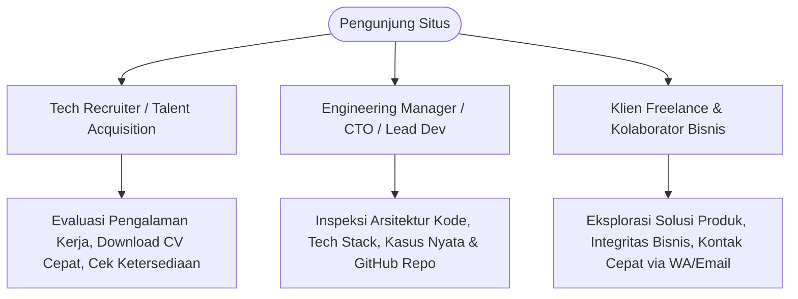

# 📄 Product Requirements Document (PRD)

| Metadata | Keterangan |
| :--- | :--- |
| **Nama Proyek** | Personal Engineering Showcase & Portfolio Website |
| **Pemilik Proyek** | Rizky Maulana (Full Stack Developer) |
| **Versi Dokumen** | v1.0.0 |
| **Status Dokumen** | Active / Baseline |
| **Tanggal Pembuatan** | Oktober 2026 |
| **Target Deployment** | GitHub Pages (`https://rizkymaulana-dev.github.io/Portofolio/`) |

---

## 1. Executive Summary & Visi Produk

### 1.1 Latar Belakang
Sebagian besar portofolio developer hanya menampilkan daftar tautan dan tangkapan layar tanpa memberikan konteks teknis mengenai masalah bisnis yang diselesaikan, kendala performa, maupun arsitektur solusi. Di industri rekayasa perangkat lunak modern, perekrut teknis (*tech recruiters*), *Engineering Managers*, dan calon klien membutuhkan bukti nyata kapabilitas teknis (*engineering competence*), kemampuan analitis, serta kepedulian terhadap kualitas kode dan performa.

### 1.2 Visi Produk
Membangun platform portofolio web dan *engineering showcase* pribadi yang:
1. **Case-Study Driven:** Menyoroti masalah (*problem*), solusi arsitektural (*solution*), serta tumpukan teknologi (*tech stack*) secara terstruktur pada setiap proyek.
2. **Ultra-Fast & Accessible:** Menghadirkan skor *Core Web Vitals* optimal mendekati 100 melalui pendekatan *Static Site Generation* (SSG) berbasis Astro, minim *JavaScript overhead*, dan ramah pembaca layar (*accessibility-friendly*).
3. **Interactive & Polished:** Memberikan pengalaman interaktif yang intuitif melalui penyaringan proyek *client-side*, penataan ulang tata letak otomatis (*auto-reordering*), serta dukungan tema gelap (*dark mode*) dan terang (*light mode*).

---

## 2. Target Audiens & Persona Pengguna

Platform ini dirancang khusus untuk memenuhi ekspektasi tiga persona utama:



### 2.1 Persona 1: Tech Recruiter (Waktu Kunjungan: 30 - 60 Detik)
- **Kebutuhan:** Memverifikasi kualifikasi, keahlian utama, domisili, status ketersediaan kerja (*availability*), dan mengunduh berkas Curriculum Vitae (CV) dalam format bahasa yang relevan (ID/EN).
- **Pain Point:** Kesulitan menemukan resume yang dapat diunduh langsung, informasi kontak yang tersembunyi, atau website yang lambat dimuat.
- **Solusi dalam Produk:** Status "Available for Work" di Hero, tombol unduh CV dwibahasa di Hero/Footer/Links, dan navigasi ringkas.

### 2.2 Persona 2: Engineering Manager / Technical Lead (Waktu Kunjungan: 2 - 5 Menit)
- **Kebutuhan:** Menilai kedalaman pemahaman teknis (Backend, Database, Full-stack, Game Logic), pola arsitektur yang digunakan, dan kebersihan kode pada repositori GitHub.
- **Pain Point:** Portofolio klise bertipe *to-do list* tanpa penjelasan arsitektural, minim *problem solving*.
- **Solusi dalam Produk:** Struktur studi kasus *Problem-Solution*, pembagian kategori (Web, Backend, Game Dev), tautan repositori GitHub publik, serta detail pencapaian kuantitatif di linimasa karier.

### 2.3 Persona 3: Klien Freelance & Kolaborator (Waktu Kunjungan: 1 - 3 Menit)
- **Kebutuhan:** Memastikan rekam jejak penyelesaian proyek sistem manajemen, e-commerce, atau game edukasi, serta akses komunikasi cepat.
- **Pain Point:** Form kontak yang rumit, tidak ada opsi chat instan.
- **Solusi dalam Produk:** Halaman *Hub Links* terpadu (`/links`), tombol email langsung dengan subjek terisi otomatis, dan kontak WhatsApp satu klik.

---

## 3. Ruang Lingkup Fitur (Feature Specifications)

### 3.1 Halaman Beranda (`/`)
Halaman utama yang merangkum proposisi nilai, keahlian, dan rekam jejak profesional dalam satu alur linier yang mengalir.

| Modul / Komponen | Fungsi & Kebutuhan Spesifik |
| :--- | :--- |
| **Navbar & Header** | <ul><li>Sticky navigation bar dengan efek *glassmorphism* (`backdrop-blur`).</li><li>Tautan navigasi halus (*smooth scroll*): `Home`, `About`, `Projects`, `Work`, `Contact`.</li><li>Pengalih tema (*Theme Toggle*) instan tanpa *flicker*.</li><li>Menu responsif hamburger untuk layar ponsel dengan animasi tinggi dinamis.</li></ul> |
| **Hero Section** | <ul><li>Pill badge ketersediaan: `👋 Available for Work`.</li><li>Judul personalisasi dengan penekanan nama Rizky Maulana.</li><li>Deskripsi nilai profesional berfokus pada arsitektur bersih dan performa.</li><li>Aksi ganda (*Dual CTA*): *Contact Me* (menuju `/links`) dan *View Projects* (menuju `/projects`).</li><li>Foto profil teroptimasi menggunakan modul `astro:assets` format WebP.</li></ul> |
| **About Section** | <ul><li>Ringkasan bio profesional dan filosofi kerja.</li><li>Tabel fakta cepat (*Quick Facts*): Lokasi, Tahun Pengalaman, Status Ketersediaan.</li><li>Metrik kuantitatif: `1+ Years Experience`, `10+ Projects Completed`.</li><li>Pill badge teknologi inti (*Core Stack*): React, TypeScript, Laravel, Tailwind, MySQL.</li></ul> |
| **Tech Stack Showcase** | <ul><li>Klasifikasi kemampuan ke dalam 6 domain teknis: Frontend, Backend, DevOps & Server, Tools & Design, AI & Automation, dan Soft Skills.</li><li>Visualisasi kartu modular dengan indikator aksen biru.</li></ul> |
| **Featured Project** | <ul><li>Menampilkan 1 proyek unggulan (*flagship*) secara eksklusif (*School Management System API*).</li><li>Format kartu detail dengan *mockup preview*, ringkasan masalah, arsitektur solusi, pembagian peran, tumpukan teknologi, tautan Demo, dan tautan Source Code.</li></ul> |
| **Experience Timeline** | <ul><li>Linimasa vertikal interaktif yang merangkum karier di Educa Studio / Gamelab.ID dan pengalaman Freelance.</li><li>Detail pencapaian berbasis poin (*bullet achievements*) dan teknologi yang digunakan.</li><li>Dukungan logika buka/tutup (*expand/collapse*) untuk pengalaman kerja lampau.</li></ul> |
| **Certificates Showcase** | <ul><li>Grid responsif 3 kolom menampilkan kartu sertifikat profesional dengan preview gambar dan overlay kategori.</li><li>Filter kategori berbasis *pill badge* interaktif di sisi klien (All, Internship, Backend, Web, Frontend).</li><li>Detail per kartu: nama sertifikat, penerbit, tanggal terbit, Credential ID, dan tombol *Lihat Kredensial*.</li><li>*Empty state handler* ketika kategori filter tidak memiliki item.</li></ul> |
| **Footer & Direct CTA** | <ul><li>Kartu ajakan kolaborasi terpadu (*Call To Action*).</li><li>Dua opsi unduh CV resmi: Versi Bahasa Indonesia (ID) dan Bahasa Inggris (EN).</li><li>Baris tautan media sosial lengkap (Gmail, GitHub, LinkedIn, Instagram, TikTok, WhatsApp).</li><li>Hak cipta dinamis berbasis tahun terkini (`new Date().getFullYear()`).</li></ul> |

### 3.2 Halaman Arsip Proyek (`/projects`)
Katalog menyeluruh seluruh proyek dan studi kasus rekayasa perangkat lunak.

| Fitur | Kebutuhan Fungsional |
| :--- | :--- |
| **Interactive Multi-Filter** | <ul><li>Dropdown filter berdasarkan **Category** (All, Web, Backend, dll.).</li><li>Dropdown filter berdasarkan **Role** (All, Fullstack Developer, Backend & System Analyst, dll.).</li><li>Eksekusi filter murni di sisi klien (*client-side*) tanpa *page reload*.</li></ul> |
| **Auto-Reorder Layout** | <ul><li>Sistem penataan ulang otomatis tata letak selang-seling (Gambar Kiri-Teks Kanan vs Teks Kiri-Gambar Kanan).</li><li>Memastikan estetika visual tetap berirama teratur meskipun elemen tengah disembunyikan oleh filter.</li></ul> |
| **Empty State Handler** | Menampilkan pesan umpan balik informatif (*"Tidak ada proyek yang sesuai dengan kriteria filter Anda"*) ketika kombinasi filter tidak menghasilkan item. |
| **Action Triggers** | Tombol demo langsung dengan status nonaktif (*disabled*) yang anggun jika tautan belum tersedia, dan tombol repositori GitHub. |

### 3.3 Halaman Tautan Ringkas (`/links`)
Halaman profil terisolasi (*Bio-Link Hub*) yang optimal untuk penggunaan di bio media sosial (Instagram, TikTok, LinkedIn, GitHub).

- **Header Profil:** Avatar bulat, nama lengkap, gelar profesi, dan deskripsi singkat.
- **Tautan Prioritas:**
  - Tautan kembali ke Website Portofolio Utama.
  - Tombol Unduh Langsung CV Bahasa Indonesia (`.pdf`).
  - Tombol Unduh Langsung CV Bahasa Inggris (`.pdf`).
- **Tautan Media Sosial & Jejaring:** Kartu tautan lebar untuk LinkedIn, GitHub, WhatsApp, Instagram, TikTok, dan Email.
- **Layout Minimalis:** Terpusat (*centered container* `max-w-md`) dan bebas distraksi.

### 3.4 Halaman Error 404 Kustom (`/404.astro`)
- Visual angka `404` yang berani (*bold display*) dengan gaya tipografi tinggi.
- Pesan kesalahan komunikatif dan ramah pengguna dalam Bahasa Indonesia.
- Tombol aksi pemulihan: *Kembali ke Beranda* (`/`) dan *Halaman Sebelumnya* (`history.back()`).
- Kalkulasi tinggi viewport fleksibel (`min-h-[calc(100vh-20rem)]`) untuk menghindari patahan footer pada layar besar.

---

## 4. Kebutuhan Non-Fungsional (Non-Functional Requirements)

### 4.1 Performa & Web Vitals
- **First Contentful Paint (FCP):** < 0.8 detik pada jaringan 4G standar.
- **Largest Contentful Paint (LCP):** < 1.2 detik (didukung `fetchpriority="high"` dan format WebP untuk aset hero).
- **Cumulative Layout Shift (CLS):** 0.00 (dimensi lebar dan tinggi ditetapkan eksplisit pada seluruh gambar).
- **Interaction to Next Paint (INP):** < 50ms (eksekusi JavaScript minimal dan tanpa framework *heavy-runtime* pada rendering teks).

### 4.2 Search Engine Optimization (SEO) & Metatags
- **Semantic HTML5:** Penggunaan elemen semantik baku (`<header>`, `<nav>`, `<main>`, `<section>`, `<article>`, `<footer>`, `<dl>`).
- **Meta Tags Komprehensif:** Title dinamis per halaman, meta description, canonical URL berdasar rute Astro, dan color-scheme.
- **OpenGraph & Twitter Card:** Pratinjau tautan lengkap saat dibagikan ke platform pesan atau media sosial (LinkedIn, WhatsApp, Telegram, X).
- **JSON-LD Structured Data:** Skema Schema.org bertipe `ProfilePage` dan `Person` dengan penandaan entitas yang valid.

### 4.3 Aksesibilitas (A11y)
- Rasio kontras teks minimal 4.5:1 terhadap latar belakang (memenuhi pedoman WCAG 2.1 Level AA) pada tema terang maupun gelap.
- Atribut `aria-label` dan `aria-expanded` pada seluruh tombol interaktif non-teks (seperti tombol hamburger dan pengalih tema).
- Dukungan media query `@media (prefers-reduced-motion: reduce)` untuk mematikan transisi *smooth scroll* bagi pengguna dengan sensitivitas gerak.

### 4.4 Kompatibilitas Browser & Lingkungan
- Kompatibel dengan semua browser modern (*evergreen browsers*): Chrome, Edge, Safari, Firefox.
- Responsif penuh (*Mobile-first*) untuk resolusi layar:
  - Mobile: 320px – 639px
  - Tablet: 640px – 1023px
  - Desktop: 1024px – 1440px+

---

## 5. Arsitektur Data (Single Source of Truth)

Seluruh konten data situs diisolasi dari komponen presentasi ke dalam berkas TypeScript pada direktori `src/data/`:

```text
src/data/
├── profile.ts      # Data identitas, bio, ketersediaan, metrik pengalaman, core stack
├── projects.ts     # Koleksi studi kasus proyek beserta problem, solution, tech stack, URL
├── experience.ts   # Linimasa karier profesional, perusahaan, periode, dan pencapaian
├── skills.ts       # Taksonomi keahlian teknis (Frontend, Backend, DevOps, AI, Tools)
├── certificates.ts # Koleksi sertifikasi profesional, penerbit, credential ID, dan URL
├── navigation.ts   # Konfigurasi menu navigasi dan routing anchor
├── socials.ts      # Daftar tautan sosial, email bertemplate, dan ikon
└── portofolio.ts   # Konfigurasi fallback identitas portofolio
```

---

## 6. Rencana Pengembangan Lanjutan (Product Roadmap)

| Fase | Inisiatif | Deskripsi & Target Fitur |
| :--- | :--- | :--- |
| **Fase 1 (Selesai)** | *Core Showcase & Foundation* | Rilis beranda, sistem tema, filter proyek, linimasa kerja, dan halaman `/links`. |
| **Fase 2 (Aktif)** | *Documentation & Governance* | Pembuatan dokumen PRD, Desain Sistem, dan standardisasi alur CI/CD. |
| **Fase 3 (Mendatang)** | *Dynamic Case Study Pages* | Implementasi rute dinamis `src/pages/projects/[slug].astro` untuk artikel bedah arsitektur mendalam dengan integrasi Markdown/MDX. |
| **Fase 4 (Mendatang)** | *Secret Admin & Analytics* | Pengembangan antarmuka `src/pages/rahasia-admin/` untuk pemantauan analitik kunjungan, pelacakan unduhan CV, dan manajemen status ketersediaan kerja. |
| **Fase 5 (Mendatang)** | *Interactive Demos* | Integrasi web emulator atau micro-sandbox langsung pada browser untuk game Phaser.js dan visualisasi API REST. |
