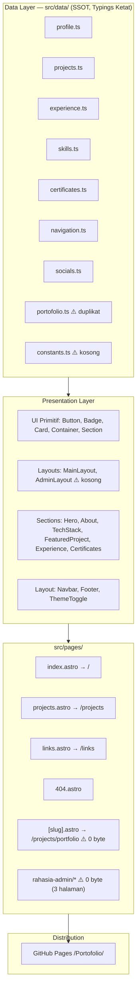
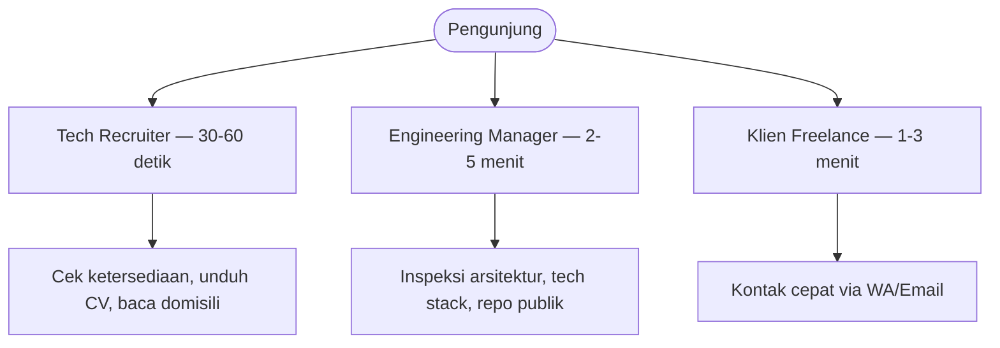

# 📄 Product Requirements Document (PRD)

| Metadata | Keterangan |
| :--- | :--- |
| **Nama Proyek** | Personal Engineering Showcase & Portfolio Website |
| **Pemilik Proyek** | Rizky Maulana (Full Stack Developer) |
| **Versi Dokumen** | v2.0.0 |
| **Status Dokumen** | As-Built Baseline + Gap Analysis |
| **Tanggal Pembuatan** | Oktober 2026 |
| **Supersedes** | v1.0.0 |
| **Target Deployment** | GitHub Pages (`https://rizkymaulana-dev.github.io/Portofolio/`) |
| **Dokumen Terkait** | [DESIGN.md](DESIGN.md) · [REMEDIATION.md](REMEDIATION.md) |

> **Dokumen ini adalah snapshot dari kode yang benar-benar ada.** Semua klaim di bawah telah diverifikasi terhadap hasil `npm run build` dan `dist/`, bukan terhadap niat. Daftar temuan, bug, dan perubahan desain ada di **[REMEDIATION.md](REMEDIATION.md)** — baca dokumen itu sebelum mengerjakan apa pun.

---

## 1. Executive Summary

### 1.1 Masalah yang Diselesaikan

Portofolio developer generik menampilkan tautan dan screenshot tanpa konteks teknis. Target pengguna — tech recruiter, engineering manager, dan klien freelance — membutuhkan bukti kapabilitas: masalah bisnis yang diselesaikan, keputusan arsitektur, dan kebersihan kode. Situs ini menjawabnya lewat *case-study driven* showcase yang dibangun sebagai **Static Site Generation** (Astro), dengan JavaScript seminimal mungkin.

### 1.2 Realitas Implementasi Saat Ini

v1.0.0 mendeskripsikan *intent*. Hasil audit kode menunjukkan beberapa klaim PRD lama **tidak terpenuhi**:

| Klaim PRD v1.0.0 | Status Aktual | Bukti |
| :--- | :--- | :--- |
| Astro v4/v5 | ❌ **Astro 7.1.1** | `package.json` |
| Halaman `/projects/:slug` studi kasus dinamis | ❌ **Rute mati**, menghasilkan HTML 0 byte | `src/pages/projects/[slug].astro` (9 baris) |
| Halaman `/rahasia-admin` dengan auth | ❌ **3 file kosong**, menghasilkan HTML 0 byte | `src/pages/rahasia-admin/*.astro` |
| `AdminLayout` dengan isolasi navigasi | ❌ **File kosong (0 byte)** | `src/layouts/AdminLayout.astro` |
| Canonical & OG URL dinamis per rute | ❌ **Canonical di-hardcode, `og:url` salah host** | `src/layouts/MainLayout.astro:28,38` |
| CLS 0.00 (dimensi eksplisit semua gambar) | ❌ **3 dari 4 `` tanpa `width`/`height`** | `projects.astro:73`, `FeaturedProject.astro:39`, `Certificates.astro:58` |
| Arsitektur data = SSOT tunggal | ⚠️ **SSOT ganda** — `profile.ts` dan `portofolio.ts` sama-sama export `profile` | `src/data/portofolio.ts` |
| `og-image.png` untuk pratinjau tautan | ❌ **File tidak ada** | `public/og-image.png` |
| Preview gambar sertifikat | ❌ **Direktori ada tapi kosong** → 6 gambar 404 | `public/images/certificates/` |
| Tombol unduh CV di Hero | ❌ **Hanya ada di Footer dan `/links`** | `Hero.astro` |

**Kesimpulan eksekutif:** situs secara visual berfungsi dan build lolos, tetapi **belum layak disebut "production-ready"** karena tiga kelas masalah: (a) empat halaman kosong ter-deploy, (b) SEOCanonical/OpenGraph salah sehingga setiap tautan yang dibagikan ke LinkedIn/WhatsApp menampilkan URL yang tidak ada, dan (c) bug CSS cascade membuat background halaman tidak mengikuti toggle tema. Detail dan urutan perbaikannya di REMEDIATION.md.

---

## 2. Arsitektur Sistem (As-Built)

### 2.1 Stack Terverifikasi



**Komposisi output build terverifikasi:** 8 halaman HTML, ~2.187 baris TypeScript/Astro di `src/`, 1 file CSS bundle (56 KB).

### 2.2 Catatan Konfigurasi Kritis

| Konfigurasi | Nilai | Risiko |
| :--- | :--- | :--- |
| `astro.config.mjs` `site` | `https://github.com/RizkyMaulana-Dev.github.io` | ❌ Bukan origin sebenarnya. `Astro.url` diturunkan dari sini → **`og:url` jadi `https://github.com/Portofolio/`** |
| `astro.config.mjs` `base` | `/Portofolio` | ✅ Benar. Semua aset WAJIB lewat `import.meta.env.BASE_URL` |
| `tailwind.config.mjs` | `darkMode: 'class'` | ⚠️ **Diabaikan Tailwind v4.** yang berlaku adalah `@custom-variant dark` di `src/styles/global.css:8` |
| Dark mode | Class `.dark` + `localStorage.theme` + anti-FOUC inline | ⚠️ Berfungsi, tapi background `<body>` dikendalikan media query OS, bukan class (lihat §5.1) |

---

## 3. Persona Pengguna & Kebutuhan



Tidak berubah dari v1.0.0. Yang berubah: **Tech recruiter tidak bisa menyelesaikan tugasnya** karena (a) `#footer` di navigasi tidak menunjuk ke elemen apa pun — footer sebenarnya ber-`id="contact"` — dan (b) halaman `/projects/portfolio` dan `/rahasia-admin/*` mengembalikan dokumen kosong, yaitu tautan mati yang langsung merusak kredibilitas begitu visitor mengetiknya.

---

## 4. Spesifikasi Fitur (As-Built)

### 4.1 Halaman Beranda (`/`)

| Komponen | File | Implementasi Terverifikasi |
| :--- | :--- | :--- |
| Navbar | `layout/Navbar.astro` | Sticky, `backdrop-blur-xl`, 7 item navigasi dari `navigation.ts`, animasi mobile via CSS `grid-template-rows: 0fr→1fr` tanpa JS berat |
| Theme Toggle | `layout/ThemeToggle.astro` | Inline SVG matahari/bulan, persist ke `localStorage("theme")` |
| Hero | `sections/Hero.astro` | Badge "Available for Work", H1 dari `profile.name.split(" - ")[0]`, 2 CTA (Contact→`/links`, Projects→`/projects`), foto profil via `astro:assets` `fetchpriority="high"` |
| About | `sections/About.astro` | `id="about"`, Quick Facts `<dl>` (Location/Experience/Status), 2 metrik (years, projects), Core Stack dengan ikon |
| Tech Stack | `sections/TechStack.astro` | `id="skills"`, 12 skill bar beranimasi via `IntersectionObserver` + `requestAnimationFrame` (eased cubic), 6 kategori tool |
| Featured Project | `sections/FeaturedProject.astro` | `id="projects"`, **grid semua proyek** (bukan 1 unggulan seperti klaim v1.0.0) |
| Experience | `sections/Experience.astro` | `id="work"`, linimasa vertikal 2 entri. ⚠️ Logika `hidden-exp` untuk `index >= 2` + tombol toggle **dikomentari** (lihat REMEDIATION B7) |
| Certificates | `sections/Certificates.astro` | `id="certificates"`, 6 kartu, filter pill (All/Internship/Backend/Web/Frontend) client-side + empty state |
| Footer | `layout/Footer.astro` | `id="contact"` (**bukan `footer"` — nav `#footer` rusak**), CTA card, tombol Email + CV ID + CV EN, 6 social pill, copyright dinamis |

### 4.2 Arsip Proyek (`/projects`)

| Fitur | Status |
| :--- | :--- |
| Layout alternating 12-kolom (gambar 7 / teks 5) | ✅ |
| Filter dropdown Category + Role | ✅ nilai unik diekstrak otomatis dari data |
| Auto-reorder kiri/kanan setelah filter | ✅ counter `visibleCount`, toggle `lg:order-first/last` |
| Empty state | ✅ `#no-results-msg` |
| Tombol Demo disabled bila `liveUrl` kosong | ✅ |
| **Judul proyek** | ❌ Render `toLowerCase()` + `capitalize` → **"School Management System Api"** |

### 4.3 Bio-Link Hub (`/links`)

✅ Avatar, tombol Portfolio, unduh CV ID/EN, 6 social card, container `max-w-md`. ❌ H1 menampilkan `profile.name` lengkap termasuk tagline.

### 4.4 404

✅ Visual 404 + copy Bahasa Indonesia + tombol recovery. ❌ `href="/"` **tidak menghormati `base`** dan `href="javascript:history.back()"` adalah anti-pattern.

### 4.5 Halaman Kosong (Harus Dihapus)

| Rute | Sumber | Status Output |
| :--- | :--- | :--- |
| `/projects/portfolio` | `src/pages/projects/[slug].astro` | **0 byte HTML** |
| `/rahasia-admin/` | `src/pages/rahasia-admin/index.astro` | **0 byte HTML** |
| `/rahasia-admin/login/` | `src/pages/rahasia-admin/login.astro` | **0 byte HTML** |
| `/rahasia-admin/dashboard/` | `src/pages/rahasia-admin/dashboard.astro` | **0 byte HTML** |

File `src/pages/projects/index` (tanpa ekstensi) dan `src/utils/constants.ts` juga kosong.

---

## 5. Kebutuhan Non-Fungsional — Status vs Target

### 5.1 Performa & Web Vitals

| Metrik | Target | Status |
| :--- | :--- | :--- |
| FCP | < 0.8 dtk | ✅ Kemungkinan tercapai — tanpa framework runtime |
| LCP | < 1.2 dtk | ⚠️ Risiko: `og:image.png` tidak ada; LCP hero = foto profil WebP ✅ |
| **CLS** | **0.00** | ❌ **3 `` tanpa `width`/`height`** → layout shift saat load |
| INP | < 50 ms | ✅ ~1.100 baris JS inline total, tanpa framework |
| **Background mengikuti tema** | Ya | ❌ **Bug cascade — lihat §5.4** |

### 5.2 SEO & Open Graph — ❌ PRIORITAS TERTINGGI

Ini masalah paling merusak secara bisnis: **setiap tautan yang dibagikan ke LinkedIn/WhatsApp/Telegram saat ini menampilkan metadata yang salah.**

| Tag | Nilai Ter-build (terverifikasi di `dist/`) | Seharusnya |
| :--- | :--- | :--- |
| `og:url` | `https://github.com/Portofolio/` ❌ | `https://rizkymaulana-dev.github.io/Portofolio/` |
| `twitter:url` | `https://github.com/Portofolio/` ❌ | idem |
| `og:image` | `https://github.com/og-image.png` ❌ | `.../Portofolio/og-image.png` (file juga hilang) |
| `twitter:image` | `https://github.com/og-image.png` ❌ | idem |
| `rel=canonical` | `https://rizkymaulana-dev.github.io/Portofolio/` ⚠️ | hardcode di semua halaman — salah untuk `/projects`, `/links`, `/404` |
| `apple-touch-icon` | `/apple-touch-icon.png` ❌ | `/Portofolio/apple-touch-icon.png` (tanpa prefix base) + file hilang |
| `<html lang>` | `en` ⚠️ | `lang="id-ID"` sesuai `SITE.locale` |
| JSON-LD | `ProfilePage` + `Person` ✅ | Handler GitHub tidak konsisten dengan `projects.ts` |
| `robots.txt` | — | ❌ Tidak ada di `public/` |
| `site.webmanifest` | `"name": "Portfolio Backend Developer"` ⚠️ | Sudah pivot ke Full Stack |

### 5.3 Aksesibilitas

| Item | Status |
| :--- | :--- |
| `prefers-reduced-motion` | ✅ Dihormati (`global.css:26-36`) + guard skill bar |
| `aria-label` di tombol ikon | ✅ Navbar, ThemeToggle |
| `aria-expanded` di hamburger | ✅ Di-toggle oleh JS |
| Label `<select>` terhubung | ✅ `for="filter-category"` |
| Kontras WCAG AA | ⚠️ Belum diukur otomatis |
| **`aria-pressed` di filter sertifikat** | ❌ Tidak ada — screen reader tidak tahu kategori aktif |
| Menu mobile tertutup setelah klik link | ❌ Tidak ada handler |

### 5.4 Bug Theming Kritis (Verified)

`src/styles/global.css:14-24` mendefinisikan background `<body>` **di luar `@layer`**:

```css
body { background: linear-gradient(to bottom, #ffffff 0%, #f8fafc 100%); }
@media (prefers-color-scheme: dark) {
  body { background: linear-gradient(to bottom, #0f172a 0%, #1e293b 100%); }
}
```

Utility Tailwind (`bg-white`, `dark:bg-neutral-950`) berada di `@layer utilities`. **Aturan unlayered selalu menang atas aturan berlayer** pada cascade CSS, apa pun spesifisitasnya. Terverifikasi di browser:

| Skenario | `body` background | Teks heading | Hasil |
| :--- | :--- | :--- | :--- |
| OS terang, mode terang | gradien putih | gelap | ✅ |
| OS gelap, mode gelap | gradien slate | putih | ✅ |
| **OS gelap, user toggle ke TERANG** | **gradien slate** ❌ | gelap (`text-neutral-900`) | ❌ **Kontras hancur** |

Konsekuensi tambahan: warna surface gelap adalah **slate `#0f172a`**, bukan token `neutral-950` `#0a0a0a` yang dideklarasikan DESIGN.md — sistem warna tidak konsisten dengan dokumennya sendiri.

---

## 6. Model Data

### 6.1 SSOT yang Seharusnya (Target)

```
src/data/
├── profile.ts       # identitas, bio, ketersediaan, metrik, core stack
├── projects.ts      # CaseStudy[]: problem, solution, techStack, category, role, year, URL
├── experience.ts    # Experience[]: role, company, period, achievements, techStack
├── skills.ts        # Skill[] (level/icon/color) + TechCategory[] (taksonomi tool)
├── certificates.ts  # Certificate[]: title, issuer, date, credentialId/Url, image, category
├── navigation.ts    # NavigationItem[]: title, href
└── socials.ts       # nama, url, icon
```

### 6.2 Deviasi dari Target

| Deviasi | Lokasi | Dampak |
| :--- | :--- | :--- |
| `profile` diekspor dua kali dengan isi berbeda | `data/profile.ts` vs `data/portofolio.ts` | Dua sumber kebenaran yang saling bertentangan; `portofolio.ts` tidak diimpor mana pun → hapus |
| `profile.name` berisi tagline | `profile.ts:2` | Memaksa `.split(" - ")[0]` di 2 tempat; bocor mentah di H1 `/links` dan copyright Footer |
| `yearsExperience: 1` dengan komentar "Sesuaikan angka ini" | `profile.ts:14-15` | Angka hardcode yang harus diperbarui manual setiap tahun; sumber tunggal untuk metrik yang tampil di 3 tempat |
| Username GitHub tidak konsisten | `socials.ts` & JSON-LD `RizkyMaulana310807` vs `projects.ts` `RizkyMaulana-Dev` | Satu dari keduanya salah |
| Email Gmail placeholder | `socials.ts:4` `emailkamu@gmail.com` | Bertentangan dengan `profile.email` |
| `credentialId` berisi `XXXX-XXXX` | `certificates.ts` (6×) | Kredensial palsu terlihat lebih buruk daripada tidak ditampilkan |
| `image` menunjuk direktori kosong | `certificates.ts` (6×) | 6 request 404 per halaman beranda |

---

## 7. Backlog Prioritas

### P0 — Kerugian reputasi aktif, perbaiki sebelum deploy berikutnya

| # | Item |
| :--- | :--- |
| P0.1 | Hapus 4 halaman kosong + `AdminLayout.astro` + `projects/index` + `constants.ts` |
| P0.2 | Perbaiki `site:` di `astro.config.mjs` → derivasi `og:url`/`twitter:url` benar |
| P0.3 | Buat `public/og-image.png` (1200×630) + perbaiki path-nya |
| P0.4 | Perbaiki bug cascade `body` background di `global.css` |
| P0.5 | Perbaiki `href="/"` di 404 agar menghormati `BASE_URL`; ganti `javascript:history.back()` |
| P0.6 | Ganti `emailkamu@gmail.com` dengan email asli |
| P0.7 | Isi atau hapus `public/images/certificates/` |

### P1 — Credibilitas & akurasi

| # | Item |
| :--- | :--- |
| P1.1 | Hapus `XXXX-XXXX` dari credential ID, atau tampilkan ID hanya jika ada |
| P1.2 | Pisahkan `name` dan `tagline` di `profile.ts`; hapus `.split(" - ")` di semua pemanggil |
| P1.3 | Hapus `portofolio.ts`; tetapkan satu SSOT |
| P1.4 | Seragamkan username GitHub di seluruh repo |
| P1.5 | Tambahkan `width`/`height` ke 3 `` untuk CLS 0.00 |
| P1.6 | Perbaiki title proyek (`toLowerCase` + `capitalize` → capitalize correct) |
| P1.7 | `#footer` → `#contact` di `navigation.ts` |
| P1.8 | Tambah `astro check` ke CI; workflow hanya jalan di `main` tapi semua kerja ada di `agent` |

### P2 — Peningkatan kualitas

`aria-pressed` pada filter sertifikat · canonical per-rute · `lang="id-ID"` · `robots.txt` · `sitemap` · hapus CSS mati (`.text-blue-gradient`, `.fade-in-up`, `.stagger`, `.section`, `.card`) · hapus dependency mati (`zod`, `vite-tsconfig-paths`) · pasang `prettier-plugin-astro` + `prettier-plugin-tailwindcss` (ada di `.prettierrc` tapi tidak terinstal) · searahkan `tailwind.config.mjs` dengan Tailwind v4

### P3 — Ekspansi (hanya setelah P0–P2 selesai)

Studi kasus dinamis `/projects/[slug]` yang benar · halaman admin dengan proteksi auth · Lighthouse CI · view transitions

---

## 8. Roadmap

| Fase | Status | Deliverable |
| :--- | :--- | :--- |
| **Fase 1** — Core Showcase | ✅ Selesai | Beranda, tema, filter proyek, linimasa, `/links` |
| **Fase 2** — Documentation | ✅ Selesai | PRD + DESIGN + REMEDIATION |
| **Fase 3** — Remediation | 🔴 **Aktif** | P0 + P1 (§7) |
| **Fase 4** — Dynamic Case Study | ⏸ Tertunda | `[slug].astro` dengan content collection |
| **Fase 5** — Admin & Analytics | ⏸ Tertunda | Hanya setelah auth nyata, bukan stub kosong |

> **Aturan:** jangan mulai Fase 4/5 sebelum P0 selesai. Empat halaman kosong di produksi lebih buruk daripada tidak punya fitur tersebut sama sekali.